# Looks

## One grammar, several media

Every look draws the same way and differs only in its medium. Ribbons are the engraved ones (MOLSCRIPT's geometry,
colour carried in lines along each face), and sticks follow them: next to engraved ribbons a side chain or ligand is
drawn with the same lines along each bond, so the whole figure reads as one drawing. A mechanism drawn only in sticks
keeps its hand-drawn sticks (`stick_style="auto"`; set it to `"engraved"`, `"sketch"` or `"flat"` to choose). All looks share one
pen (width 1.6, hierarchy 0.45; chalk keeps a broader stick, Assembly cartoon a thin one for huge complexes), and
what makes a look loose or crisp is its **hand**, one number from 0 (a ruled, engraved line) to 1 (a loose sketch)
that sets roughness, passes, pen pressure and fill wobble together: Flat 0, Engraved 0.08, Ink 0.55, Watercolour and
Dark paper 0.6, Chalkboard 0.72. The medium supplies the rest: ink leaves the faces paper, chalk leaves them board, and
watercolour lays a pale wash of the colour under darker lines.

In the app, the *hand* slider is at the top of *Look › Lines*.

## Using a look

```python
import molsketch as ms
fig = ms.scene("examples/mechanism.json").look("ink-colour")      # Python
```

```bash
molsketch render examples/mechanism.json --look ink-colour -o fig.png    # the command line
```

In the app, pick it under *Looks*. A look sets every field of the style at once; whatever you change afterwards
(`fig.set(...)`, `--set`, the app's panels) applies on top. A look carries no camera: a scene brings its own view,
and a structure is turned so its widest spread faces you.

Each look is also a complete style file in [`looks/`](../looks), what the app's *Export › Save style* writes. The app's
*Load style*, `fig.apply_style("looks/ink.json")` and `molsketch render --style looks/ink.json` read them. The tables
below list what each look changes from the defaults; every field is explained in
[python/docs/style.md](../python/docs/style.md).

Every image here is made by [`tools/make_images.py`](../tools/make_images.py) at 960 × 720 (or the size shown); for
real output use `scale=2` or `3`, which only changes the pixel density, not the drawing.

---

## 1. Watercolour

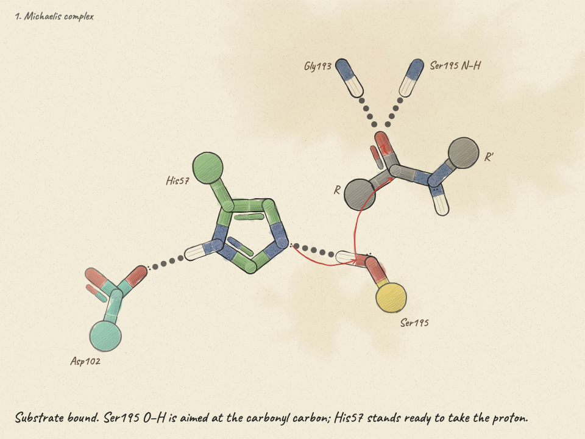

The default for finished work. Fills are stacked translucent layers with fractal edges, a darker drying ring
and granulation, multiplied over cream paper that has its own faint wash pools. The pools are alive: with every
drawing their edges creep a few pixels along slow noise tracks and their density rises and falls, as a wash does
while it dries, so an animation's background changes subtly from frame to frame instead of sitting still under
the moving strokes.

```python
ms.scene("examples/mechanism.json").look("watercolour").save("mechanism.png", (960, 720), frame=28)
```

Frame 28 is the end of the first hold (holds are 30 frames; curly arrows draw during the last 40 % of a hold, so they
are complete by 28). `fig.save_frames("out/")` renders the whole animation, one file per drawing.

| field | value | why |
|---|---|---|
| `fill` | `"watercolour"` | the fill engine |
| `palette` | the *Colored pencil* preset | cream paper `#f3ecd9`, warm ink `#2b2a28`, muted element colours (C `#6b6660`, N `#3f5fa8`, O `#c94b3c`, S `#c9a227`), wash `#d1a35b` |
| hand | 0.6 | `line.rough` 1.08, `line.passes` 2, `line.pressure` 0.42, `fill_wobble` 0.84 |
| `paper.wash` | `0.3` (default) | strength of the paper's wash pools; 0 gives clean paper, 0.5 is noticeably stained |
| `paper.wash_seed` | `1` (default) | which pool layout; change it if a pool sits under something important |
| `paper.wash_life` | `0.6` (default) | how much the pools creep and breathe from drawing to drawing; 0 freezes them |

Residue colours in this image come from the scene (`groupColors` in `examples/mechanism.json`: Ser195 yellow, His57
green, Asp102 teal). With a structure and no colours of your own, carbons follow `color_by`.

The same look on a structure, cartoon plus ligand sticks, then as a surface coloured by residue:

| | |
|---|---|
| 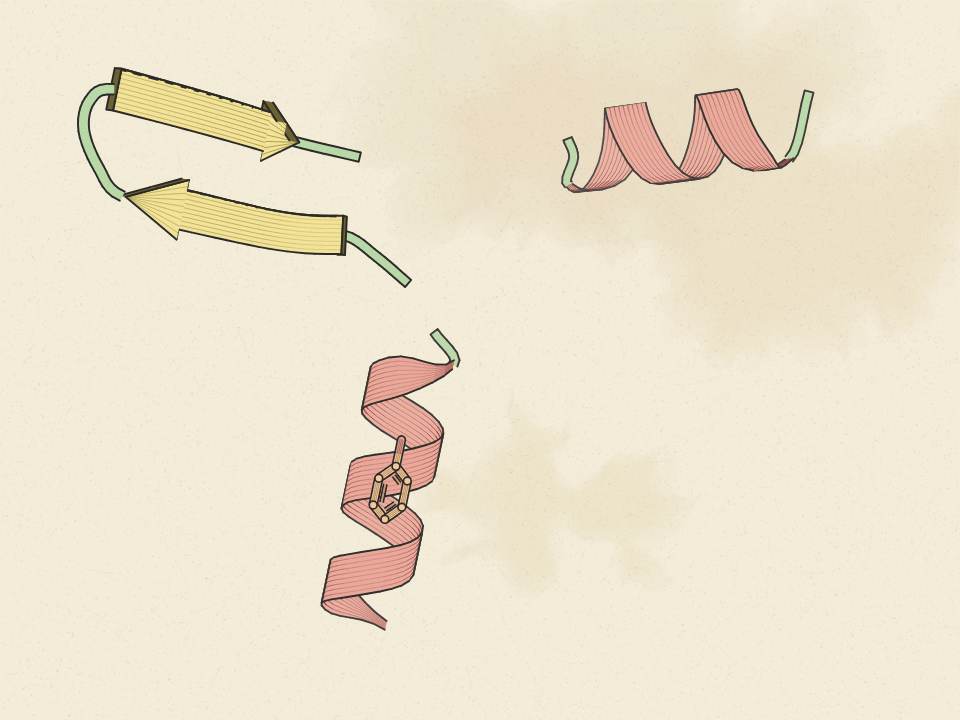 | 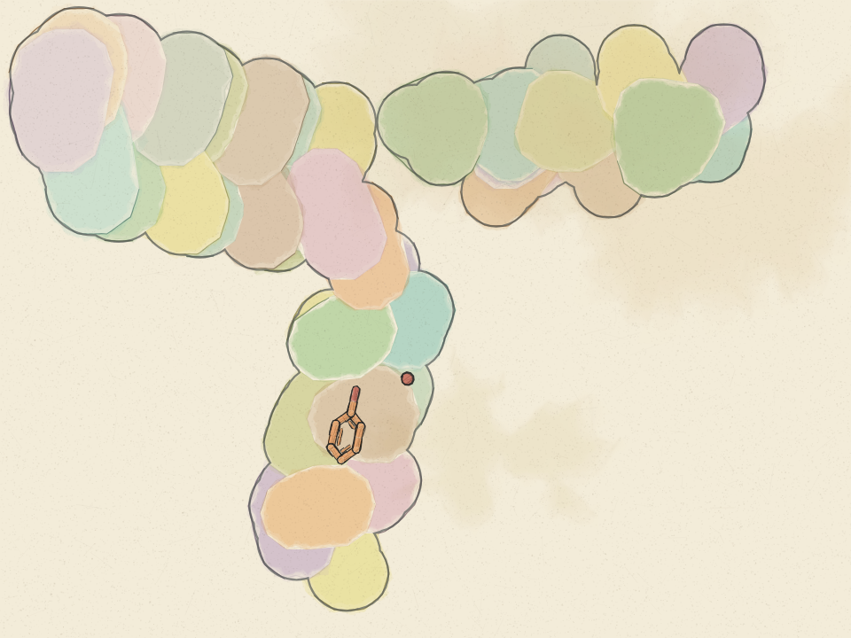 |

```python
base = ms.load("examples/test_protein.pdb").look("watercolour").view(yaw=30, pitch=20)
base.copy().save("cartoon.png", (960, 720))
base.copy().show(cartoon=None, surface="polymer", sticks="hetatm").set(surface_color="residue").save("surface.png", (960, 720))
```

A structure draws its polymer as cartoon and its ligands (`hetatm and not water`) as sticks unless you say otherwise;
the second figure turns the cartoon off and the surface on, one patch per residue in the automatic residue palette
(no blues or reds, so they never read as N or O). A surface shows its depth with ink edges, pigment pooled in the
grooves and a fade into the paper (`surface_depth`).

## 2. Ink colour

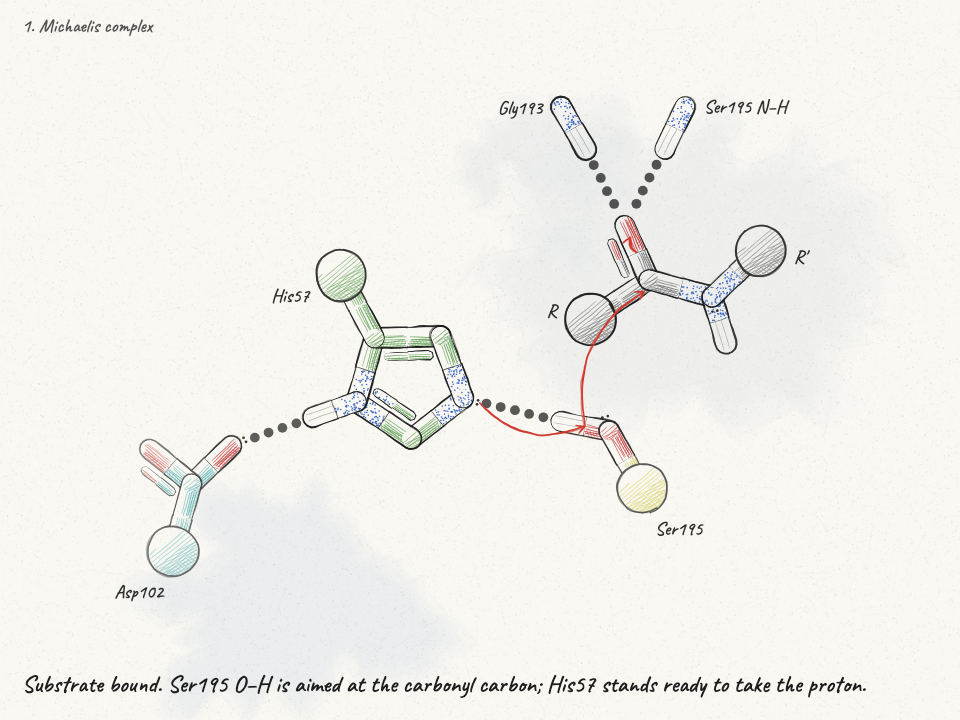

Pen and ink with a hint of colour: no fills, the paper shows through everything; nitrogen is stippled, oxygen
hatched, sulphur cross-hatched, carbon gets a sparse hatch in its residue colour; a tick marks each bond midpoint.
This is the look closest to the pen-drawn reference the project started from.

| field | value | why |
|---|---|---|
| `fill` | `"ink colour"` | hatching takes the element or residue colour |
| `palette` | the *PyMOL flat* preset | white paper `#faf8f3`, near-black ink, PyMOL element colours; the wash is a cool blue-grey `#7fb2c9` |
| hand | 0.55 | |
| `paper.wash_seed` | `6` | a pool layout that keeps the big pool away from the histidine ring on this scene |
| `engrave.lines`, `engrave.width` | `5`, `1.1` | engraved ribbons with fewer, heavier coloured lines |

Fields worth knowing: `hatch.spacing` (5 px) and `hatch.density` (1.4) set how dense the hatching is; `line.width`
(1.6) the outline weight; `line.hierarchy` (0.45) how much lighter inner marks are than outlines; `line.passes` how
many times each line is drawn over.

## 3. Ink

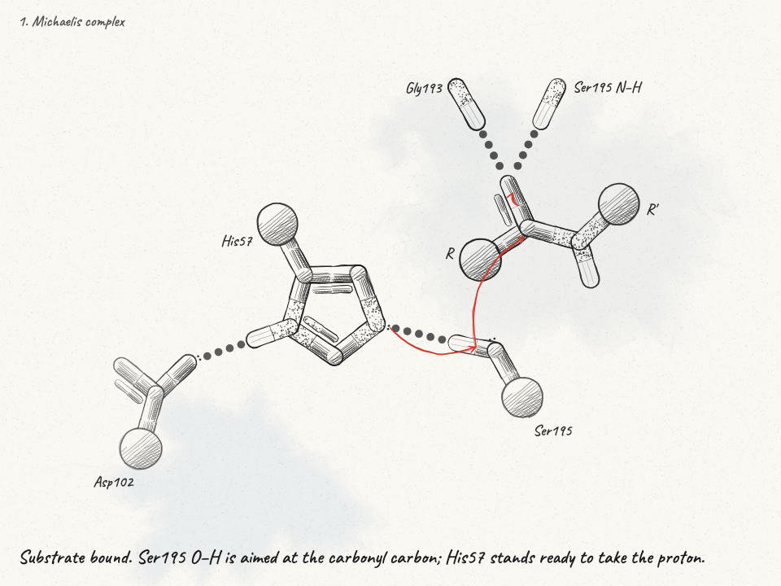

The same in black ink only, so the two can be swapped without retuning.

| field | value |
|---|---|
| `fill` | `"ink"` |
| `paper.wash_seed` | `6` |

For pure line art with no paper wash at all, add `fig.set(paper={"wash": 0, "grain": 0})`.

## 4. Pencil

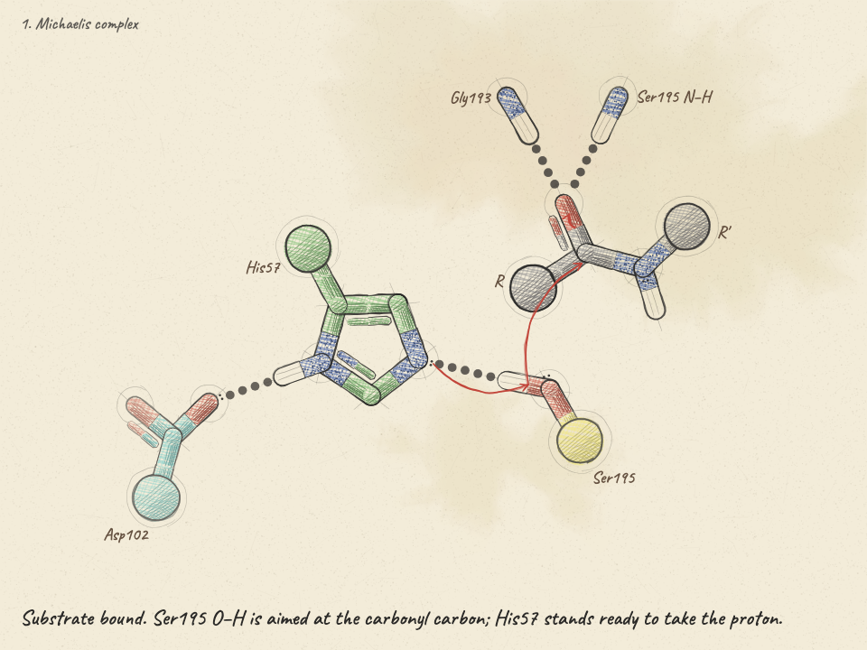

Coloured-pencil scribble fills that stray past the outline, and construction lines (the faint circles and guide
strokes an illustrator leaves in). There is no Pencil look of its own: it is any look with the pencil fill, and reads
best on the watercolour look's cream paper.

```python
ms.scene("examples/mechanism.json").look("watercolour").set(fill="pencil", construction=True).save("pencil.png", frame=28)
```

`pencil_fill` (0.55) is the scribble density and `fill_wobble` how far the fill strays from the line.

## 5. Dark paper

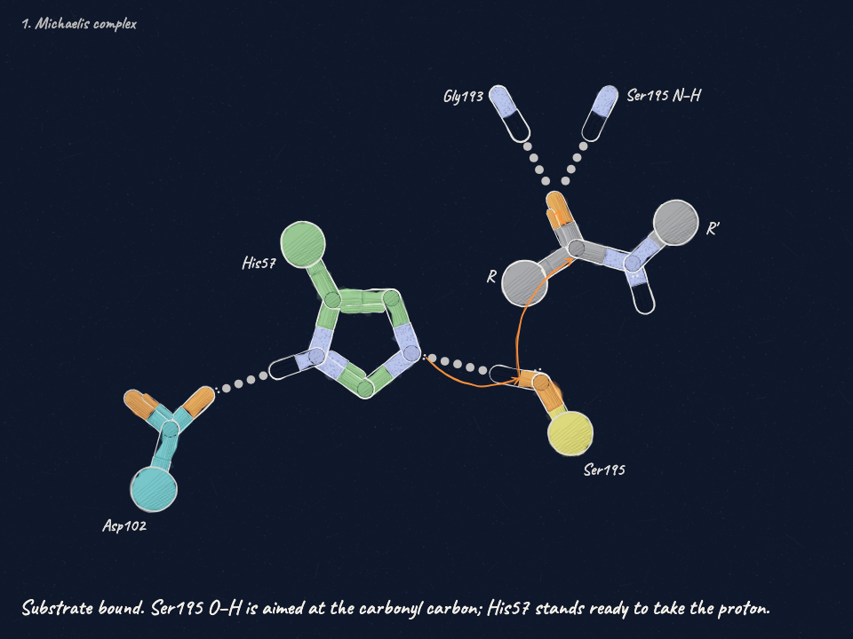

Watercolour on the navy of the lab website (`#0f172a`): pale ink, pigment laid down under the translucent layers
(screened layers alone never reach the colour on a dark ground), shading toward near-black instead of toward the
ink, no wash, lighter grain and fog. The engine switches to this behaviour whenever the paper is dark, so any dark
`palette.paper` works; this look is the tuned one. [../hero/README.md](../hero/README.md) uses it for the website hero.

| field | value | why |
|---|---|---|
| `palette` | the *Dark paper* preset | navy ground `#0f172a`, cream line `#f2efe8`, near-black shading `#05070d`; carbons pale, oxygen in the site's orange |
| `shading` | `0.45` | shadows lighter than on cream, or the sticks go muddy |
| `paper.wash` | `0` | wash pools read as dirt on a dark ground |
| `paper.grain` | `0.3` | the grain screens light speckles onto dark paper; keep it faint |
| `view.fog` | `0.2` | fog mixes toward navy, which dulls quickly |

## 6. Chalkboard

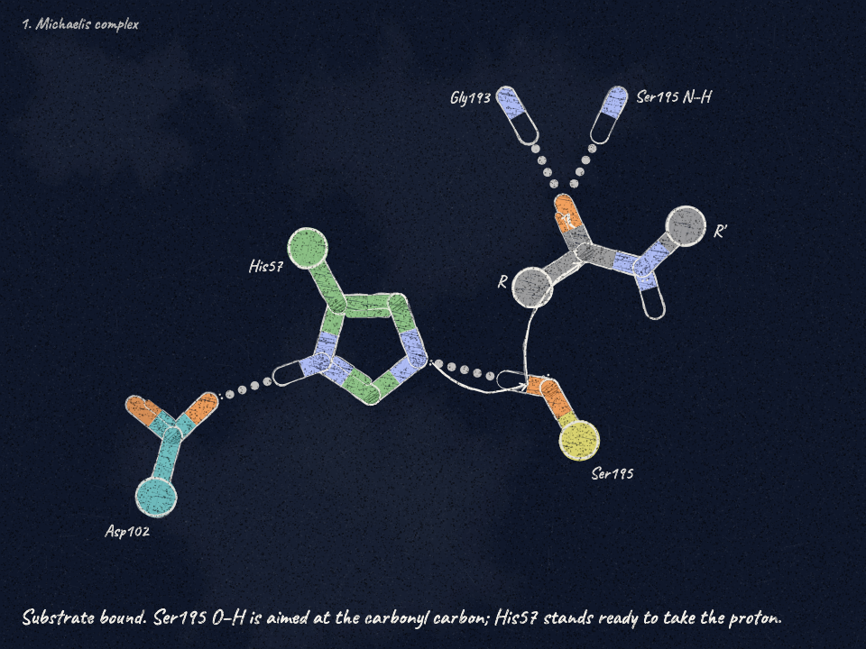

Chalk on the same navy, with a fill of its own (`fill="chalk"`): broad side-of-the-stick strokes in the pigment
colour (lightened a little, laid dense), a soft white outline, no pen hatching, and the board's tooth, a field of dark
pits multiplied over the whole drawing, so every stroke breaks up the way chalk does. A faint pale wash stands in for
chalk dust. Same palette as Dark paper, arrows in white chalk.

| field | value | why |
|---|---|---|
| `fill` | `"chalk"` | |
| `palette.arrow`, `palette.wash` | `#f2efe8`, `#e7e5e4` | white chalk arrows and dust |
| hand, `line.width` | 0.72, 2.0 | a broad, loose stick |
| `shading`, `sphere_scale` | `0.25`, `0.3` | |
| `paper` | `grain` 0.8, `wash` 0.12, `wash_seed` 3 | the board's tooth and a little dust |
| `view.fog` | `0.15` | |

## 7. Assembly surface

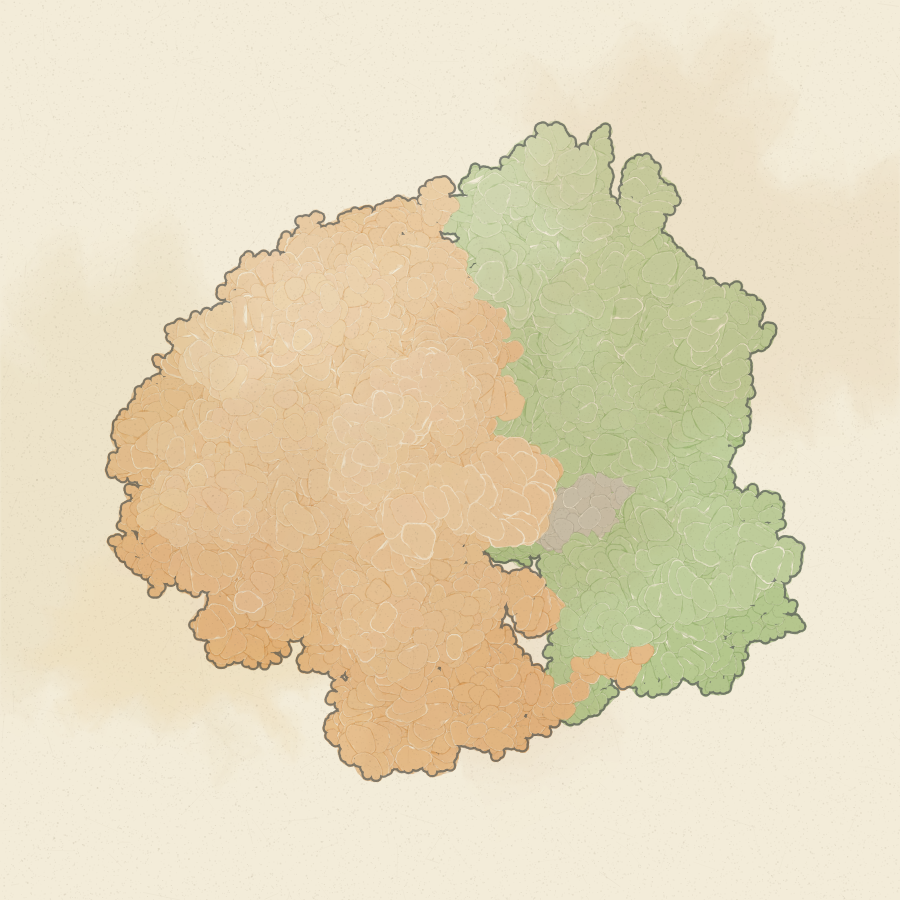

A whole complex as a watercolour surface, one colour per subunit: small subunit green, large subunit orange, tRNA
rose, everything else grey. Patches are painted back to front; ink edges where a patch stands in front of something
farther back, pigment pooled in the grooves and a fade with depth give the form.

```python
ms.fetch("6GZQ").look("assembly-surface").save("ribosome.png", (900, 900))    # the 70S ribosome, 144 138 atoms
```

| field | value | why |
|---|---|---|
| `fill` | `"watercolour"` | |
| `palette` | the *Colored pencil* preset | |
| `surface_color` | `"subunit"` | S/L/T/X from the mmCIF entity descriptions (`_entity.pdbx_description`: 30S/16S/18S/40S/"small" → S, 50S/23S/28S/25S/5.8S/5S/60S/"large" → L, tRNA/mRNA → T, anything else X); a plain PDB has no entity descriptions, so everything is X |
| `reps` | sticks and cartoon off, surface `polymer` | |

Give a subunit a colour of your own with `fig.color("subunit:L", "#e6a45a")` (or `"subunit:S"`, `"subunit:T"`). For
one colour per chain use `surface_color="chain"`; for a single colour, `surface_color="single"` with
`palette={"surface": "#cfd8e0"}`. `probe` (1.4 Å) changes how bulbous the surface is, `surface_depth` how strongly
the depth cues show, and `view.fog` and `view.fog_start` how far back the fade begins.

## 8. Assembly cartoon

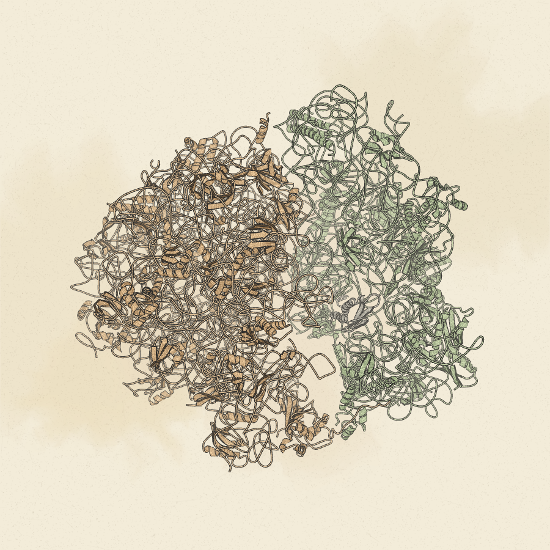

The same complex as tubes (RNA, traced along P atoms) and ribbons (protein), coloured by subunit rather than
secondary structure, with a thinner pen and heavier fog so the tangle stays legible.

| field | value | why |
|---|---|---|
| `cartoon_color`, `color_by` | `"carbon"`, `"subunit"` | colour the cartoon by subunit instead of helix / sheet / loop |
| `cartoon_scale` | `1.6` | |
| `line.width`, `line.hierarchy` | `0.8`, `0.9` | thin outlines; at full weight the dense RNA core reads as a black mass |
| `view.fog`, `view.fog_start` | `0.7`, `0.3` | a strong depth fade |
| `reps` | cartoon `polymer`, sticks and surface off | |

Secondary structure comes from `_struct_conf` / `_struct_sheet_range` when the file has them, otherwise from a
P-SEA-style geometric assignment on the Cα trace.

## 9. Engraved

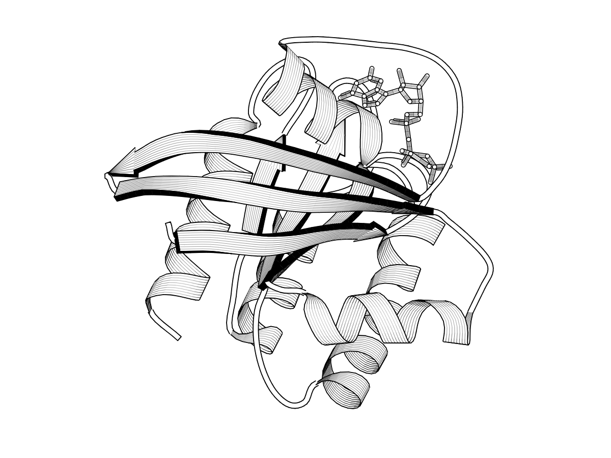

Line-shaded ribbons, black on white, as in MOLSCRIPT figures of the early 1990s (Kraulis 1991). The geometry is a
port of MOLSCRIPT 2.1's own (`graphics.c`): secondary-structure elements share their end residues as MolAuto writes
them; coils are Priestle-smoothed Hermite splines through Cα; helices are ribbons along the local helix axis (Cα
plane normal tilted 32°, tangents at −11°) that widen from the coil radius over their first and last residue;
strands are smoothed boxes whose normals are averaged and made perpendicular, ending in MOLSCRIPT's stepped
arrowhead (1.5× width, then 0.75×, then the tip). Every ribbon face is paper with straight lines running along it
at fixed fractions of its width, so they join from segment to segment and crowd where a face turns away; line weight
also rises as the face normal leaves the viewer, helix back faces are heavier still, and the narrow sides and butt
ends of strands are solid ink. Faces are painted back to front (by their nearest corner, as MOLSCRIPT does) together
with sticks and ligands.

```python
ms.fetch("5P21").look("engraved").show(sticks="hetatm and not water").view(yaw=60, pitch=20).save("ras.png", (1200, 900))
```

The image is Ras with GppNHp and Mg²⁺ (PDB 5P21, the Ras of MOLSCRIPT's own examples). Secondary structure is
MolSketch's own assignment (the file's HELIX/SHEET records, or the geometric one), so element boundaries can differ
from a MolAuto script.

| field | value | why |
|---|---|---|
| `cartoon_style` | `"engraved"` | the ribbon renderer; `"sketch"` is the hand-drawn one of the fill |
| `engrave.lines` | `8` | lines per ribbon face |
| `engrave.width` | `0.45` | line weight for a face turned to the viewer; up to ×2.35 edge-on, ×1.7 on helix backs |
| `engrave.strand_thickness` | `0.6` | Å, MOLSCRIPT's default; 0 gives flat strands |
| `engrave.coil_width` | `1.25` | × MOLSCRIPT's 0.2 Å coil radius |
| `engrave.labels` | `false` | α1, β1 … at the middle of each element (`fig.labels(secondary=True)`) |
| `fill` | `"ink"` | white fills; sticks and balls as pen and ink |
| hand | 0.08, `line.hierarchy` 0.3 | a steady ruling pen instead of a sketching hand |
| `paper.grain`, `paper.wash`, `shading` | `0` | plain white paper |
| `palette.paper`, `.ink`, `.hatch` | `#ffffff`, `#000000`, `#000000` | |
| `view.fog`, `view.fov` | `0`, `0` | no depth cue, orthographic, as in the originals |

In the app the look is *Looks › Engraved*; *cartoon style*, and, once it is engraved, *lines per face*, *line
weight*, *strand thickness*, *coil width* and *α/β labels*, are under *Look*.

### Engraved colour

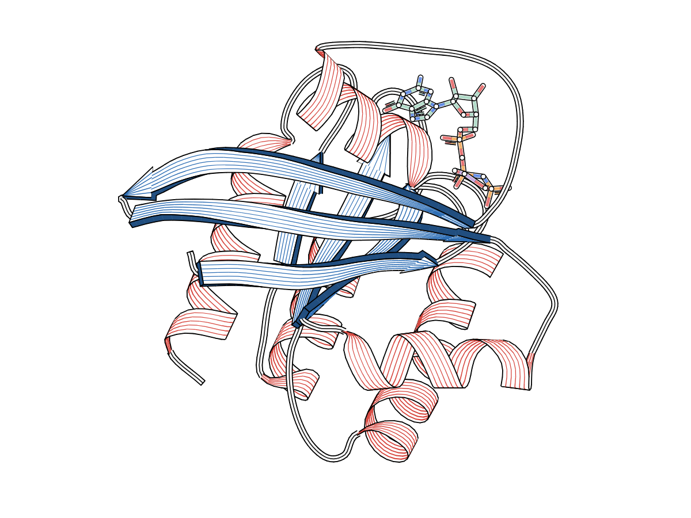

The engraved ribbons with colour only in the lines: faces stay white, and each face carries five heavier lines in its
element's colour at an even weight (so face-on ribbons keep their colour), strand sides a darker shade, coils one
coloured centre line. Helices red, strands blue by default; `cartoon_color="rainbow"` runs blue → red along each chain
(a darker ramp than the filled modes, so yellow and cyan still read on white). A group palette (`fig.palette(...)`)
picks the three ribbon colours too.

| field | value |
|---|---|
| `fill` | `"ink colour"` |
| `engrave.lines`, `engrave.width` | `5`, `1.1` |
| `palette.helix`, `.sheet`, `.loop` | `#d6453d`, `#2f6fb5`, `#1e1e1e` |

The other fills colour the engraved faces too: `"flat"` fills them with the colour and darkens the lines, `"wash"`
tints them.

## 10. Textbook

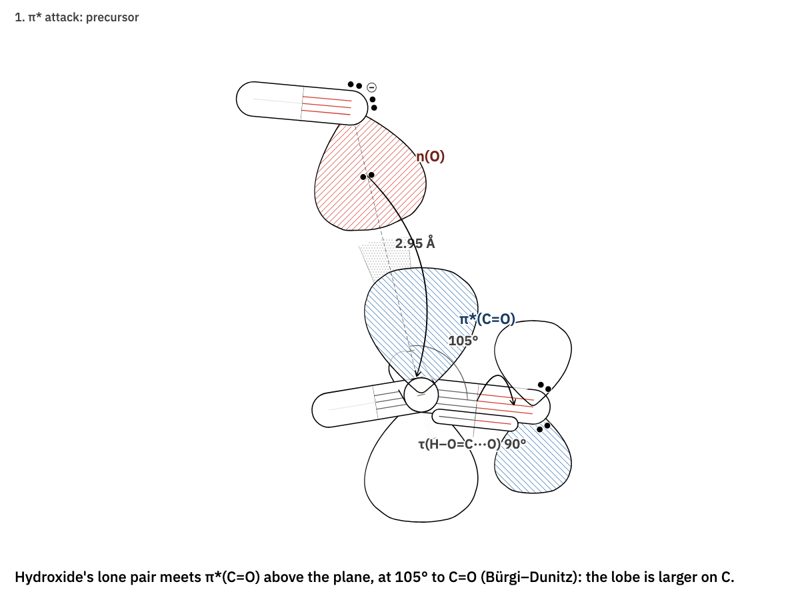

Engraved colour as a 1960s chemistry text draws a mechanism: ruled ink, colour only in the lines, labels in a plain
lettering-guide sans, curly arrows in black. It is made for scenes with orbitals and measures
([scene-format.md](scene-format.md#orbitals)). Sticks take the engraved grammar even without ribbons. Orbitals are inked
solids that knock back what lies behind them: the shaded phase is a flat ruled tint in the orbital's colour (red for a
filled orbital, blue for an empty one, ruled at right angles to each other so they stay apart in greyscale), the other
phase is white, and a filled orbital holds its electrons as two bold dots. Lone pairs are bold dot pairs set off from
the atom. A measure's window is stippled, so it never reads as an orbital.

```python
ms.scene("examples/reactions/pi_star.json").look("textbook").save("pi_star.png", (1200, 900), frame=38)
```

| field | value | why |
|---|---|---|
| `fill` | `"ink colour"` | colour only in the lines |
| `stick_style` | `"engraved"` | the engraved sticks with no ribbons in the picture |
| `orbital_style` | `"engraved"` | inked lobes with a ruled tint |
| `lone_pair_style` | `"bold"` | lone pairs as bold dots, spread clear of bonds and charges |
| `palette.filled`, `.empty` | `#d23b2f`, `#2f6fb5` | orbitals that hold electrons, and empty ones |
| `palette.arrow` | `#000000` | curly arrows in ink |
| `font`, `label_size`, `caption_size` | `"Plain sans"`, `22`, `22` | lettered labels, large enough to read at print size |
| `stick_radius` | `0.17` | thinner sticks, so the lobes have room |
| hand | 0.05 | a ruling pen |

## 11. Flat

| | |
|---|---|
| 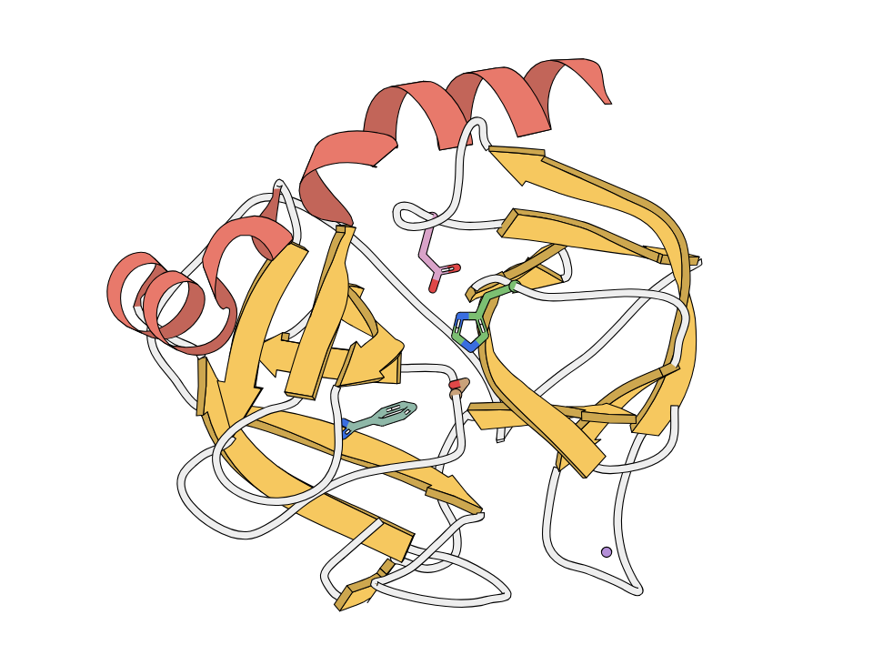 | 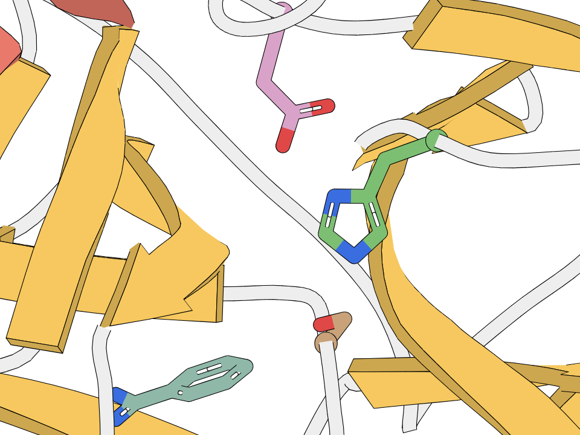 |

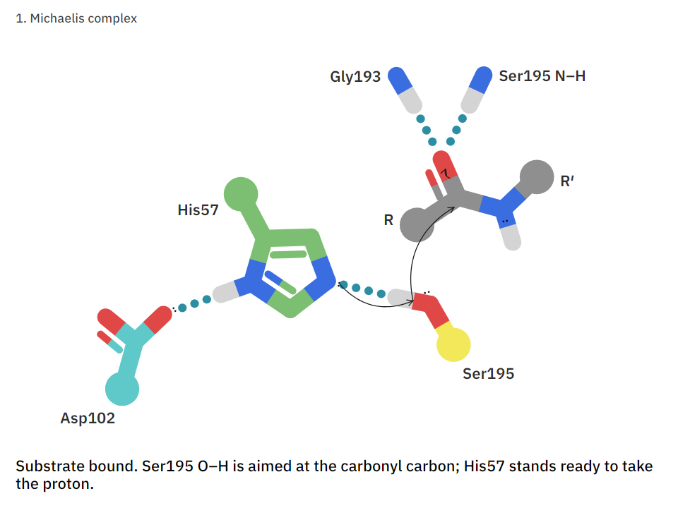

PyMOL under flat light with its outlines on (`ray_trace_mode 1`), the look of many protein-design papers, for when a
talk or a paper wants a clean illustration rather than a drawing. Ribbons keep MOLSCRIPT's geometry, filled solid: each
colour on a face, one darker shade of it on a ribbon's far side and a strand's narrow side, and a thin, even line round
them. Sticks are PyMOL's: solid colour split at each bond's middle, round joints, a ball at Cα. Beside ribbons they are
outlined as the ribbons are; on their own (a mechanism) they are plain (`stick_outline`). Outlined, an active
site's sticks need no paper halo to stand off the ribbons behind them, and have none. Hydrogen bonds are evenly
spaced round dots in a colour of their own.

A mechanism's chemistry is drawn in the same terms. A bond to a hydrogen is thinner (`stick_h_scale`), so a proton
reads lighter than the bonds it moves between. A double or triple bond is two or three lanes in the one stick, as
PyMOL draws valence, the gap between them closing before each atom so the lanes run into it. A formal charge is a
solid badge in the ink, wider than a stick, its sign drawn in the paper's colour, set off the atom in whichever
direction is clearest of its bonds, hydrogen
bonds and lone pairs (the upper right when that is as clear); lone pairs are bold pairs of dots sized from the stick,
as large as a hydrogen bond's dots, kept clear of the badge, the bonds and the hydrogen bonds.

The look keeps every colour as it is given: no grain, wash, fog or translucency, and a site is not faded into the
protein, so a figure is in exactly the colours it was handed, each in two tones. As an SVG it is shapes only: one path
per ribbon face, half-bond and outline, and the paper one rectangle (or nothing, with `paper.transparent`), so it can be
recoloured or rearranged in Illustrator, Inkscape or a figure tool, and laid on a page of its own colour.

```python
fig = ms.load("app/public/examples/trypsin_active_site.json").look("flat").site("resi 57+102+195")
fig.save("trypsin.svg", (960, 720))
fig.set(palette={"helix": "#4c78a8", "sheet": "#f2c14e", "loop": "#eeeeee"}, **{"paper.transparent": True})
```

| field | value | why |
|---|---|---|
| `fill` | `"flat"` | solid colour, two tones of each |
| `cartoon_style` | `"engraved"` | MOLSCRIPT's ribbons, filled |
| `stick_style` | `"flat"` | PyMOL's sticks; outlined beside ribbons (`stick_outline="auto"`) |
| `engrave.lines` | `0` | no lines along the faces |
| `shading` | `0.55` | the far side a sixth of the way to the ink |
| `line.width`, `line.hierarchy` | `1.1`, `0` | one thin weight for every outline |
| `palette.ink` | `#000000` | black outlines |
| `palette.helix`, `.sheet`, `.loop` | `#e8796b`, `#f6c85f`, `#eeeeee` | coral helices, amber strands, near-white loops |
| `palette.hbond`, `palette.H` | `#2b8ea3`, `#d4d4d4` | teal hydrogen bonds; hydrogens grey, as white vanishes on white |
| `stick_h_scale` | `0.55` | bonds to hydrogens thinner |
| `lone_pair_style` | `"bold"` | lone pairs as bold dots, clear of bonds and the charge |
| `stick_radius`, `sphere_scale` | `0.25`, `0.25` | PyMOL's stick, and a Cα ball twice as wide |
| `site.quiet`, `site.cutaway` | `0`, `false` | nothing faded or seen through: the site reads by its sticks |
| `font`, `label_size` | `"Plain sans"`, `22` | lettered labels |
| `view.fog`, `view.fov` | `0`, `0` | no fog, an orthographic view |
| hand | 0 | ruled |

## Turntables

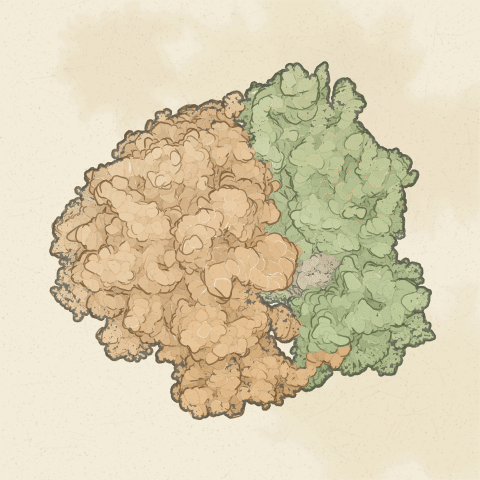

```python
ms.fetch("6GZQ").look("assembly-surface").turntable("turntable.mp4", n=36, size=(720, 720), swing=12, fps=12)
```

`n` frames make one full turn about the vertical; `swing` nods the pitch by that many degrees over the turn. 36 frames
at 12 fps is a 3-second loop; 72 or 144 give a slower, smoother turn. The lines and wash still boil from frame to
frame; `boil_hold` keeps each drawing for that many frames.

---

## Making your own look

Set things up in the app, *Export › Save style*, and put the file in `looks/`. Then:

```python
ms.scene("scene.json").apply_style("looks/mine.json").save_frames("out/")
```

```bash
molsketch render scene.json --style looks/mine.json --frames drawn -o out
```

Or start from a look in Python and change what you need: `fig.look("ink").set(line={"width": 2}, hatch={"spacing": 4})`.
`fig.style` shows the whole style a figure will be drawn with.
