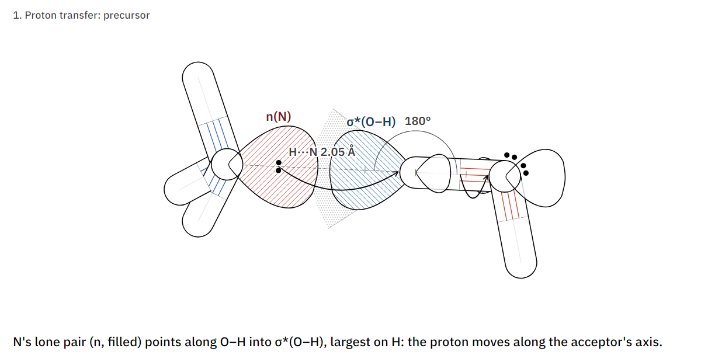
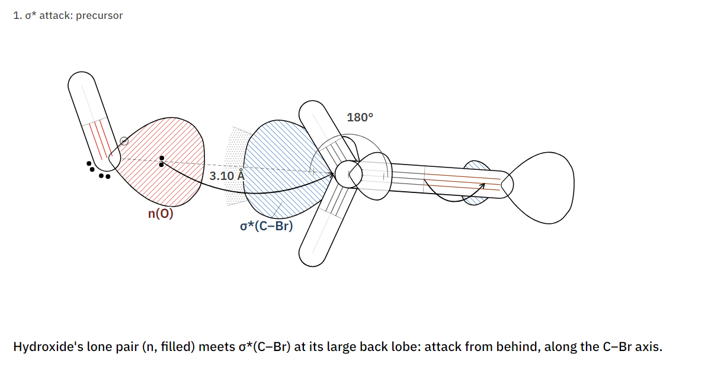
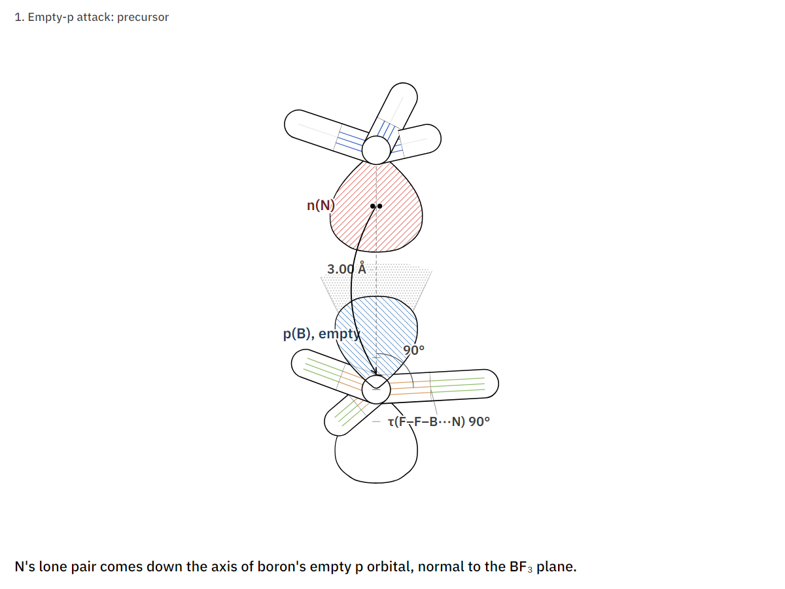
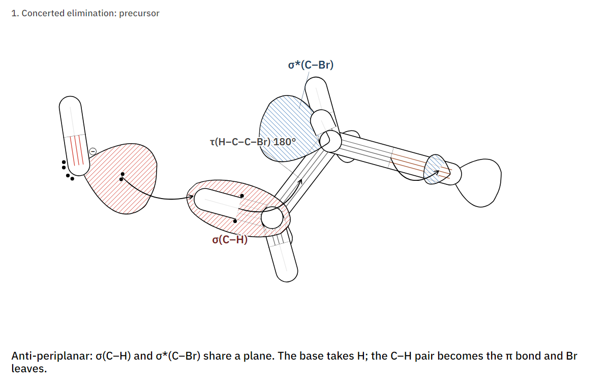

# Reaction figures: orbitals, lone pairs and approach geometry

The base reaction rules of the chemistry engine's registry v1, each drawn as the reactive precursor posed at the rule's
central values, with the orbitals that interact, the curly arrows, and the geometry the rule constrains measured from
the drawn atoms with its window. Each is a two-keyframe scene (precursor, then product), so it also animates.

```bash
pip install ./python
python tools/reaction_figures.py                      # scenes → examples/reactions/, figures → docs/img/reactions/
python tools/reaction_figures.py pi_star --animate    # one rule, and its animation as an mp4
python tools/reaction_figures.py --look watercolour   # any look; the scenes default to Textbook
```

`--svg` writes each figure as an SVG too. Every line, lobe outline, tint and dot is its own vector path, so it opens
in Illustrator, Inkscape or Affinity for recolouring or nudging. Two things to know: labels are glyph outlines (the
file looks the same without the fonts, but to reword a label change the scene and render again), and the white paper
is an embedded image at the bottom of the stack (delete it for a transparent background).

The script prints each precursor's measures against the windows, read back from the coordinates it built. The
windows live in `RULES` at the top of [`tools/reaction_figures.py`](../tools/reaction_figures.py); the report marks
these rules provisional, so change them there when the registry changes.

| rule | distance | electrophile angle | face or direction | orbitals |
|---|---|---|---|---|
| Proton transfer | H···A 2.05 ± 0.55 Å | D–H···A linear, bend ≤ 35° | the acceptor's lone pair sets the axis | n(A) → σ*(D–H), largest on H |
| σ* attack | 3.10 ± 0.45 Å | Nu···C–X 180 ± 18° | backside to the leaving bond | n(Nu) → σ*(C–X), largest behind C |
| π* attack | 2.95 ± 0.45 Å | Nu···C=O 105 ± 10° | out of plane, ±90 ± 25° | n(Nu) → π*(C=O), largest on C |
| Empty-p attack | 3.00 ± 0.40 Å | Nu···B–F 90 ± 25° | along the p axis, ±90 ± 30° | n(Nu) → empty p |
| Concerted elimination | — | — | H–C–C–X 0 or 180 ± 40° | σ(C–H) → σ*(C–X), as the base takes H |

## Proton transfer



H₃N: + H–OH. The acceptor's lone pair points along O–H; the window is the bend the rule allows at H.

## σ* attack



HO⁻ + CH₃Br (S<sub>N</sub>2). The large lobe of σ*(C–Br) is behind carbon, on the axis; the product is inverted.

## π* attack


HO⁻ + H₂C=O. Bürgi–Dunitz: above the plane (torsion 90°), at 105° to C=O, into the larger lobe of π* on carbon.

## Empty-p attack



H₃N: + BF₃. Down the axis of boron's empty p orbital, normal to the BF₃ plane; the adduct is tetrahedral at boron.

## Concerted elimination



HO⁻ + CH₃CH₂Br (E2), anti-periplanar: σ(C–H) and σ*(C–Br) share a plane, so as the base takes the proton the C–H
pair becomes the π bond and bromide leaves. The rule allows syn-periplanar too (0 ± 40°).

## Your own reactions

Copy a builder in the script. Each places the partner with `molsketch.geometry.relative_pose`, whose six coordinates
are the engine's (d, αA, αB, τA, τAB, τB for frames (A1, A2, A3) and (B1, B2, B3)), gives the reacting atom lone pairs
with `lone_pairs(..., toward=electrophile)` so the first points at it, and then lists:

```jsonc
"orbitals": [ { "type": "n", "atom": "Nu", "lp": 0, "label": "n(O)" },              // the pair that reacts
              { "type": "pi*", "bond": ["C", "O"], "toward": "Nu", "label": "π*(C=O)" } ],
"measures": [ { "distance": ["Nu", "C"], "window": [2.95, 0.45] },
              { "angle": ["Nu", "C", "O"], "window": [105, 10] } ],
"arrows":   [ { "from": { "lp": "Nu", "i": 0 }, "to": { "atom": "C" } } ]               // starts at the electrons in the lobe
```

The fields are in [scene-format.md](scene-format.md#orbitals); the look in [looks.md](looks.md#10-textbook). Open a
scene in the app (drop the JSON on it) to turn it, pick the frame, and export.
